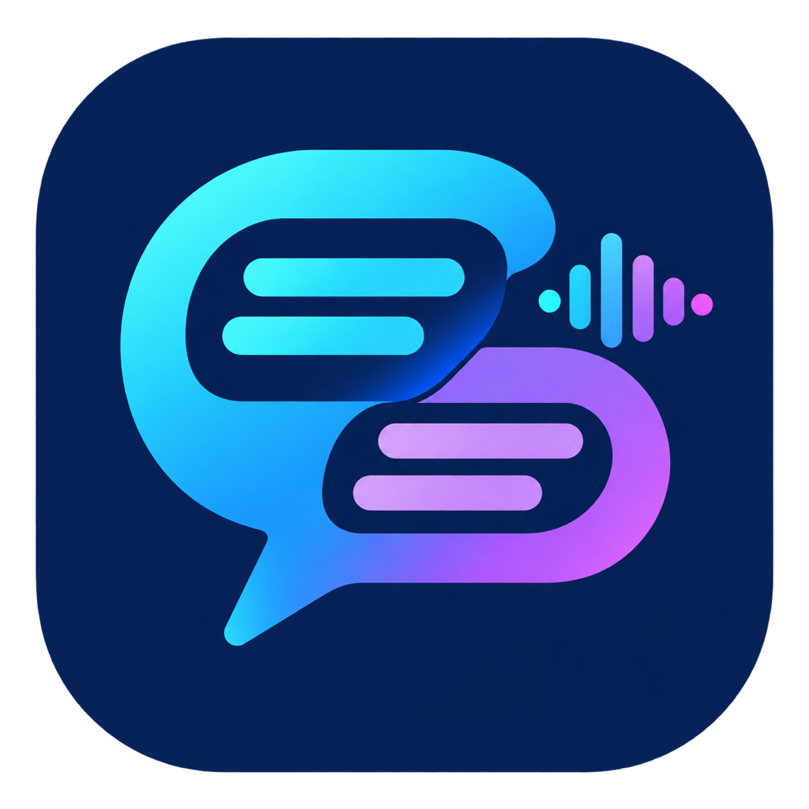
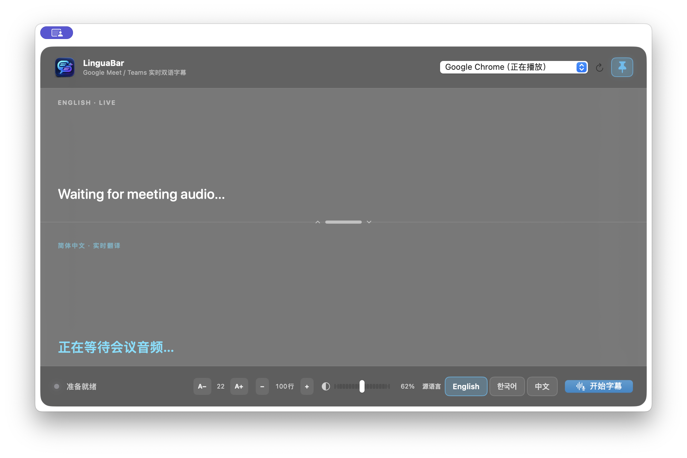
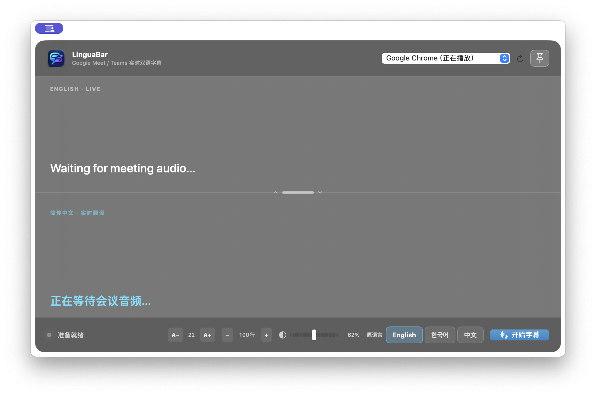

<!-- AI-Author: Codex (OpenAI model not exposed by runtime) -->
<!-- AI-Author: Codex (OpenAI gpt-5.6-sol) -->
<div align="center">

<h1>LinguaBar</h1>
<p><strong>Follow the conversation. Read it in Chinese.</strong></p>
<p>Native macOS meeting captions and Chinese translation.</p>
<p>macOS 15+ · Apple Silicon · SwiftUI · Apple Speech + Translation</p>
<p><strong>English</strong> · <a href="README.zh-CN.md">简体中文</a></p>
<p><a href="#get-started">Get started</a> · <a href="#make-it-yours">Features</a> · <a href="docs/RELEASING.md">Build a release</a></p>
</div>



*Real app screenshot in its waiting state, without private meeting content. The current app uses Chinese UI labels; documentation is available in English and Chinese.*

## A quiet companion for your next meeting

LinguaBar captures audio playing on your Mac, shows a live transcript, and translates English or Korean into Simplified Chinese. Keep it beside Google Meet or Microsoft Teams, or pin it above your meeting window.

| Listen | Read | Stay comfortable |
| --- | --- | --- |
| Google Meet, Google Chrome, Microsoft Teams, or system audio | English / Korean → Chinese; Chinese → transcript only | Adjustable split panes, type size, and background opacity |

## Make it yours

- **Meet-first defaults.** Chrome, Meet, and Teams stay visible in the source menu. Opening it refreshes running apps; unavailable entries are marked.
- **Two panes, your proportions.** Drag the divider to give the transcript or translation more room. Chinese input uses one pane.
- **Readable at your size.** Change the font from 18–56 pt and background opacity from 30–96%. Text wraps to the window width.
- **A manageable history.** Keep the latest 100 semantic lines by default, adjustable from 25–500. Scroll up to pause following; return to the bottom to follow live captions again.
- **Preferences that stick.** Font size, opacity, language, history limit, and audio source return when you reopen the app.
- **Native controls.** Pin the window, drag its background, and start or stop captions with `⌘⇧Space`.

The flat, shadow-free Dock icon reflects capture status: a neutral marker while requesting permission, green play while listening, amber during a reconnect warning, red on capture failure, and the plain icon when idle or stopped. It reports capture state, not whether speech or translation is arriving. Third-party app switchers that cache static bundle icons may not reflect live changes.

### Complete session text, saved when you stop

LinguaBar saves each non-empty start-to-stop session as UTF-8 text in `Documents/LinguaBar`:

The filenames below are illustrative examples.

- `Original/2026-09-28-09-30-(project-budget-review).txt`: the complete source transcript.
- `Chinese/2026-09-28-09-30-(project-budget-review).txt`: the full Chinese translation for English or Korean sessions. Chinese input creates only the Original file.

Filenames combine the session's local start time with a sanitized English keyword summary. Korean and Chinese sessions may use a best-effort on-device English title translation; if it is unavailable or has no usable keywords, the filename uses `meeting-notes`. Collisions get a numeric suffix, never an overwrite. Clear, the on-screen line limit, and the ten-minute display retention affect only what is shown; they do not delete text already collected for the session archive. The original is saved first, followed by a full chunked Chinese translation when applicable; it may differ in wording from the live preview. The bottom bar shows progress, a save-folder shortcut, and retry on failure. Do not force-quit before saving finishes. Empty sessions create no files; Documents access or translation language downloads may be needed.

<details>
<summary>See the unpinned appearance</summary>



</details>

## Get started

**Requires macOS 15 or later.** The v0.2.4 binary targets Apple Silicon (`arm64`); Intel is not included or validated.

1. Download [LinguaBar-0.2.4-macos-arm64.zip](https://github.com/wangzheng422/linguabar/releases/download/v0.2.4/LinguaBar-0.2.4-macos-arm64.zip), extract it, and drag **LinguaBar** into **Applications**.
2. Launch the app, open your meeting, and choose its audio source.
3. Select English, Korean, or Chinese, then click **开始字幕** (Start captions).
4. Allow Speech Recognition and system audio recording when macOS requests them. Apple Translation may request a language download.

LinguaBar is published in the [public GitHub repository](https://github.com/wangzheng422/linguabar). See the [release notes](docs/RELEASE_NOTES.md) and [release guide](docs/RELEASING.md).

## Engines and privacy

| Component | Implementation |
| --- | --- |
| Audio capture | Native Core Audio Process Tap; no virtual audio driver required |
| Live transcription | Apple Speech (`SFSpeechRecognizer`) |
| Chinese translation | Apple Translation on-device language models; initial downloads may be needed |
| Punctuation | Apple punctuation plus pause-based comma / period hints |

No third-party AI API key is required. Apple Speech may use Apple's servers depending on language and system support: **LinguaBar does not force offline recognition**. LinguaBar does not save audio recordings. Complete transcript and applicable translation files are saved to Documents after stopping; clearing the display or the ten-minute display retention does not delete session archives. They may sync if your Documents folder is cloud-synced. Manage or delete these archives according to your meeting privacy requirements. Preferences are stored locally.

**Capture scope:** Google Meet in Chrome uses the Chrome process tree, so other Chrome tabs may also be captured. This is not isolated per-tab audio. Pause other browser audio when needed. Stop captions before changing the capture source or language.

## Build from source

Install Xcode or Command Line Tools with a macOS 15+ SDK, then run from the repository root:

```sh
./script/build_and_run.sh
```

Run checks or create an optimized release without restarting your current app:

```sh
./script/verify.sh
./script/release.sh
```

The [release guide](docs/RELEASING.md) covers DMG, ZIP, matching source archives, checksums, signing, and notarization. See the [release notes](docs/RELEASE_NOTES.md).

## Troubleshooting

| Symptom | What to check |
| --- | --- |
| Captured audio stays silent | Check system audio recording permission, selected source, and actual speech playback; restart capture. The warning alone does not prove a permission failure. |
| An app is unavailable | Start it and reopen the source menu. Meet in Chrome shares Chrome's capture target. |
| Translation is missing | Complete the language download. Chinese input intentionally hides translation. |
| Sparse punctuation | Pause-based hints are approximate; continuous speech may still form long sentences. |

## Open source and acknowledgments

LinguaBar is distributed under [GNU AGPL v3](LICENSE). The Core Audio implementation derives from [Sokuji](https://github.com/kizuna-ai-lab/sokuji), pinned in [upstream.lock](upstream.lock). See [third-party notices](THIRD_PARTY_NOTICES.md). Release archives include the license and notices, with a matching source archive alongside the binaries.
