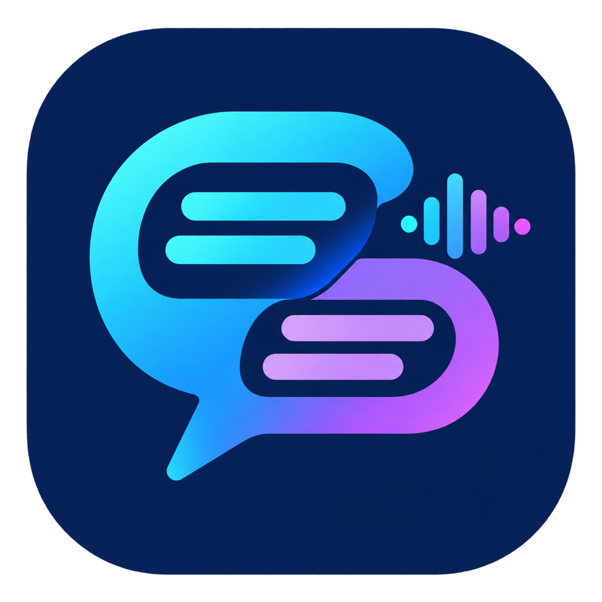
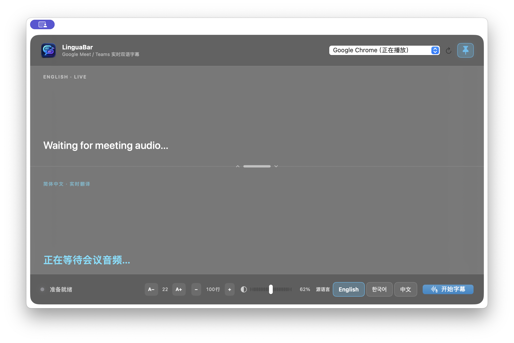
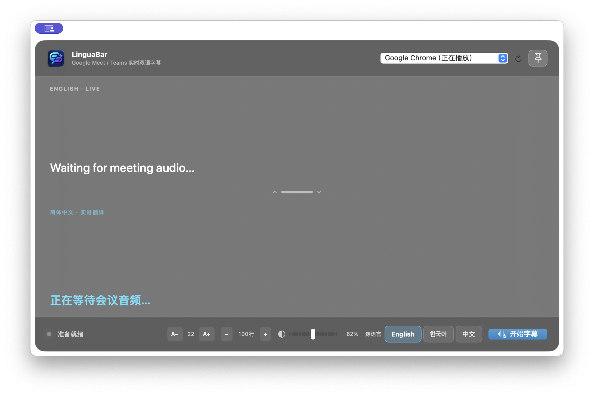

<!-- AI-Author: Codex (OpenAI model not exposed by runtime) -->
<div align="center">

<h1>LinguaBar</h1>
<p><strong>听见世界，用中文跟上每一句。</strong></p>
<p>为 macOS 打造的原生会议实时字幕与中文翻译工具。</p>
<p>macOS 15+ · Apple Silicon · SwiftUI · Apple Speech + Translation</p>
<p><a href="README.md">English</a> · <strong>简体中文</strong></p>
<p><a href="#开始使用">开始使用</a> · <a href="#让字幕适合你">功能介绍</a> · <a href="docs/RELEASING.md">制作发行版</a></p>
</div>



*真实应用截图，展示等待音频状态，不含私人会议内容。当前应用界面采用中文标签，项目说明提供中英文两个版本。*

## 给会议多一层理解

LinguaBar 直接读取 Mac 正在播放的音频，实时显示原文，并将英文或韩文翻译成简体中文。把它放在 Google Meet、Microsoft Teams 旁边，或置顶在会议窗口上方。

| 听什么 | 看什么 | 怎么看 |
| --- | --- | --- |
| Google Meet、Google Chrome、Microsoft Teams 或系统音频 | 英文／韩文 → 中文；中文 → 仅转写 | 可拖动双语分隔条、可调字号、半透明背景 |

## 让字幕适合你

- **默认优先 Meet。** Chrome、Meet、Teams 始终出现在来源菜单中；每次展开自动刷新，未运行项明确标注。
- **上下比例自由调。** 拖动中间分隔条调整原文和译文空间；中文输入时仅显示一个字幕区域。
- **舒服地阅读。** 18–56 pt 字号、30–96% 背景不透明度，文字随窗口宽度自然折行。
- **历史不会无限堆积。** 默认保留最近 100 个语义行，可调为 25–500 行；上滚暂停跟随，回到底部自动继续。
- **记住你的习惯。** 字号、透明度、语言、历史上限和音频源在下次启动时恢复。
- **原生桌面操作。** 图钉置顶、空白处拖动窗口，`⌘⇧Space` 开始或停止字幕。

扁平、无阴影的 Dock 图标会显示采集状态：请求权限时为中性色标记，监听时为绿色播放标记，重连警告为黄色，采集失败为红色；空闲或停止时恢复普通图标。它表示采集状态，不代表一定有语音输入或翻译结果。缓存静态应用图标的第三方切换栏可能不会同步显示动态标记。

### 停止后自动保存整场文字

LinguaBar 将每次非空的开始到停止记录为一场，并自动保存 UTF-8 文本到“文稿/LinguaBar”：

以下文件名仅为示例。

- `Original/2026-09-28-09-30-(project-budget-review).txt`：完整原文。
- `Chinese/2026-09-28-09-30-(project-budget-review).txt`：英文或韩文场次的全文中文翻译。
- 中文输入只生成 Original 文件。文件名包含本场本地开始时间和经过清理的英文关键词摘要。韩文或中文场次会尽力使用设备端翻译生成英文文件名；翻译不可用或没有可用关键词时回退为 `meeting-notes`。同名自动加数字后缀，不覆盖旧记录。

清空按钮、屏幕历史上限和十分钟显示保留期只影响窗口显示，不会删除已采集到的本场完整归档。停止后先保存原文，适用时再分段翻译完整中文译文；保存状态和“保存目录”入口位于窗口底部。全文译文可能与实时预览措辞不同。若写入或翻译失败，可点击“重试保存”；完成前请勿强制退出。空白监听不会生成文件，首次使用可能需要文稿目录权限或苹果翻译语言包。

<details>
<summary>查看取消置顶后的外观</summary>



</details>

## 开始使用

**需要 macOS 15 或更新版本。** 当前 v0.2.1 安装包面向 Apple Silicon（`arm64`），尚未包含或验证 Intel 版本。

1. 下载 [LinguaBar-0.2.1-macos-arm64.dmg](https://github.com/wangzheng422/linguabar/releases/download/v0.2.1/LinguaBar-0.2.1-macos-arm64.dmg)，将 **LinguaBar** 拖入 **Applications**。
2. 启动应用，打开会议，选择音频来源。
3. 选择 English、한국어 或中文，然后点击 **开始字幕**。
4. 按 macOS 提示允许语音识别、系统音频录制；首次翻译可能需要下载语言包。

LinguaBar 已在 [GitHub 公开仓库](https://github.com/wangzheng422/linguabar)发布。0.2.1 App 与 DMG 已于 2026-09-28 通过 Apple 公证并附加票据；Gatekeeper 将该 App 识别为 **Notarized Developer ID**。详见[发布说明](docs/RELEASE_NOTES.md)和[发行指南](docs/RELEASING.md)。

## 引擎与隐私

| 环节 | 使用的技术 |
| --- | --- |
| 音频采集 | 原生 Core Audio Process Tap，无需虚拟声卡驱动 |
| 实时转写 | Apple Speech（`SFSpeechRecognizer`） |
| 中文翻译 | Apple Translation 设备端语言模型，首次可能下载资源 |
| 标点增强 | Apple 标点配合按停顿补充的逗号和句号 |

无需第三方 AI API Key。Apple Speech 是否使用苹果服务器取决于系统与语言支持，**当前并未强制离线识别**。应用不会保存录音；停止后会把完整转写及适用的中文翻译保存到文稿目录，清空屏幕或十分钟显示保留期不会删除场次归档。若系统开启了文稿目录云同步，文件也可能随之同步。请根据会议隐私要求自行保管或删除归档。偏好存储在本机。

**采集范围：** Chrome 中的 Google Meet 使用 Chrome 进程树音频，因此其他 Chrome 标签页的声音也可能被捕获，并非单标签页隔离。需要时暂停其他网页音频。切换音频源和识别语言前请先停止字幕。

## 从源码运行

安装带 macOS 15+ SDK 的 Xcode 或 Command Line Tools，在仓库根目录执行：

```sh
./script/build_and_run.sh
```

运行检查，或制作优化后的发行版（不会重启正在运行的应用）：

```sh
./script/verify.sh
./script/release.sh
```

[发行指南](docs/RELEASING.md)包含 DMG、ZIP、对应源码包、校验和、签名与公证步骤；另见[发布说明](docs/RELEASE_NOTES.md)。

## 常见问题

| 现象 | 检查方法 |
| --- | --- |
| 持续提示音频静音 | 检查系统音频录制权限、来源选择和实际语音播放，再重启捕获。静音提示本身不能证明权限被拒绝。 |
| 应用显示未运行 | 启动后重新展开菜单；Chrome 网页版 Meet 共用 Chrome 采集目标。 |
| 没有中文翻译 | 完成语言资源下载；源语言选择中文时会主动隐藏翻译区域。 |
| 标点不够准确 | 停顿标点是近似规则，连续发言仍可能形成较长句子。 |

## 开源与致谢

LinguaBar 按 [GNU AGPL v3](LICENSE) 分发。Core Audio 采集实现衍生自 [Sokuji](https://github.com/kizuna-ai-lab/sokuji)，上游版本固定在 [upstream.lock](upstream.lock)。原始路径与提交见[第三方声明](THIRD_PARTY_NOTICES.md)。发行文件包含许可和来源说明，并在二进制旁提供对应源码包。
